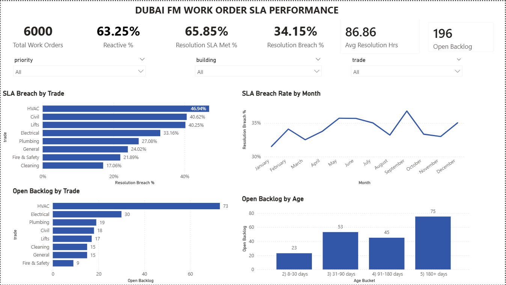

# Dubai FM Work Order SLA Performance Analysis

Facility management work order analysis: reactive vs preventive maintenance ratio, response and resolution times, SLA breach rate, backlog ageing, and repeat jobs by asset. Built with SQL, Python and Power BI on **simulated data**.



## Problem

Facility management teams are measured on how quickly they respond to and fix issues, and whether they meet agreed service levels (SLAs). Reporting often stops at "how many jobs did we close". This project goes further and asks:

- Are we preventing breakdowns, or mostly fixing them after they happen?
- How fast do we respond and resolve, and which jobs miss their SLA?
- Which trades and priorities cause the most breaches?
- How old is the open backlog?
- Which assets keep failing, and what do they cost?

## Data

The dataset is **simulated**. It contains no real company data. A Python script (`scripts/generate_work_orders.py`) generates 6,000 work orders for 2025 across 8 buildings and 8 trades, with a fixed random seed so results can be reproduced.

Each row is one work order, with the asset, building, trade, job type (reactive or preventive), priority (P1 to P4), created, responded and closed timestamps, SLA targets, response and resolution hours, SLA met flags, status, reopened flag and cost in AED.

Some realistic patterns were built in so the analysis has something to find: a few trades breach SLAs more often, a few assets fail repeatedly, and a small share of jobs stay open as a backlog.

## Approach

1. **Python:** generate the work order dataset (`pandas`, `numpy`).
2. **SQL (SQLite):** one query per metric, in the `SQL` folder.
3. **Power BI:** a dashboard with KPI cards, slicers (priority, building, trade) and four charts, built with DAX measures.

| File | Question it answers |
|---|---|
| `01_reactive_vs_preventive.sql` | What share of jobs is reactive vs preventive? |
| `02_sla_performance_by_priority.sql` | How fast do we respond and resolve, and how often do we breach SLA, by priority? |
| `03_sla_breach_by_trade.sql` | Which trades miss their resolution SLA most often? |
| `04_backlog_ageing.sql` | How old are the open jobs? |
| `05_repeat_failures_by_asset.sql` | Which assets keep failing, and what do they cost? |

## Key findings

*These findings come from simulated data and show what the analysis is designed to detect.*

- **63% of work is reactive.** 63.25% of jobs are reactive and 36.75% are preventive, so most of the team's time goes on fixing failures rather than preventing them.
- **One in three jobs misses its resolution SLA.** The overall resolution SLA met rate is 65.85%, a breach rate of 34.15%. The average resolution time is 86.9 hours, driven mainly by low-priority jobs (about 153 hours for P4, against about 5 hours for P1).
- **HVAC is the biggest problem trade.** It has the highest breach rate (46.9%), followed by Civil (40.6%) and Lifts (40.3%). Cleaning has the lowest (17.1%).
- **The backlog is old.** 196 jobs are still open, and about 38% of them are more than 180 days old. HVAC alone accounts for 73 of the open jobs, about 37% of the backlog.
- **A handful of assets cause repeated failures.** The worst three assets (AHU-604 at Office Park, AHU-202 at Tower B and DB-303 at Retail Podium) account for 362 reactive jobs, with nearly every one coming within 30 days of the previous failure on the same asset. AHU-604 alone cost about AED 193,000 in reactive work.

## What a manager could do with this

- Shift effort towards preventive maintenance on HVAC and lifts, where breaches are highest.
- Review the oldest open jobs first. Jobs stuck for more than 180 days are usually waiting on parts, approvals or a vendor.
- Repair or replace the worst-performing assets properly, instead of repeating call-outs.

## Dashboard

The Power BI file is in `work_order_dashboard.pbix`. It includes six KPI cards (total work orders, reactive %, SLA met %, breach %, average resolution hours, open backlog), three dropdown slicers, and charts for SLA breach by trade, SLA breach by month, open backlog by trade and open backlog by age.

## How to run it

```
pip install pandas numpy
python scripts/generate_work_orders.py
```

This creates `data/work_orders.csv`. Import it into SQLite (for example with DB Browser for SQLite) as a table called `work_orders`, then run the queries in the `SQL` folder. Open the `.pbix` file in Power BI Desktop to see the dashboard.

## Notes and limitations

- The data is simulated, and the repeat-failure pattern is deliberately stronger than it would be in real life, where an asset failing every few days would be replaced.
- Backlog ageing uses a fixed snapshot date of 15 Jan 2026. The SQL query and the Power BI chart differ by a few jobs per bucket (for example 74 vs 75 in the 180+ day group), because SQL counts exact elapsed time and Power BI counts calendar days. Both total 196.
- Tools: Python (pandas, numpy), SQL (SQLite), Power BI (DAX).

## Author

Anagha Nair
